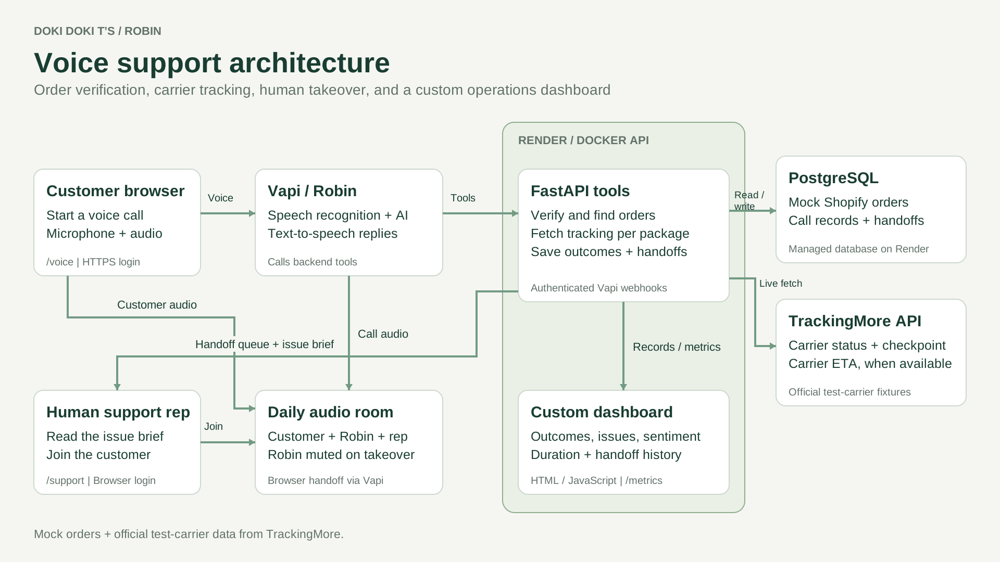

# WISMO Voice Agent — Robin

A browser-based voice agent that answers "Where is my order?" (WISMO) calls for an e-commerce store, with a live handoff to a human support rep when the customer needs one.

Robin verifies the caller, looks up their order, checks the carrier for each package, and explains the status in plain speech. It never invents a delivery date, refund or transfer. When a person is needed, a rep joins the same audio room with an AI-written brief, so the customer doesn't have to repeat themselves. A custom dashboard tracks outcomes, sentiment, call duration and handoffs.

The store, **Doki Doki T’s**, is a fictional T-shirt shop. All customers and orders are mock data.

<!-- Walkthrough video: add the unlisted YouTube link here -->
<!-- Screenshots: add docs/screenshots/voice.png, support.png and dashboard.png, then uncomment:
| Customer call | Support desk | Dashboard |
| --- | --- | --- |
|  |  |  |
-->



## What it does

- **Verifies before it discloses.** An order number plus email, or an order number plus postcode, is enough. An order number alone reveals nothing. Email-only lookup finds multiple orders and asks the caller which one they mean.
- **Tracks every package separately.** Split shipments are explained package by package. Unshipped items are described as unshipped, with no guessed dates.
- **Only reports carrier ETAs.** The store's original estimate is kept out of the voice tools entirely, so the agent can't present it as a delivery date.
- **Treats "delivered" carefully.** Carrier-marked delivered isn't proof of receipt. Robin asks whether the parcel arrived and moves to the missing-delivery flow only if the caller says so.
- **Hands off honestly.** A handoff request, a rep joining, and confirmed two-way audio are recorded as separate states. If no rep is available, Robin says so and doesn't promise a callback.
- **Minimizes personal data.** Email, phone and full address are stripped from tool results before they reach the language model, and from the rep's brief.

## How it works

1. The customer starts a browser call at `/voice`. Vapi handles speech recognition, the language model and Robin's voice.
2. During the call, Vapi invokes authenticated tools on the FastAPI backend: `lookup_order`, `track_order`, `record_outcome` and `request_human`.
3. Tracking comes from the TrackingMore v4 API. If the carrier can't be reached, Robin says it can't confirm the status and offers human help.
4. For a handoff, a rep marks themselves available at `/support`, reads the brief and joins the same Daily audio room. The backend asks Vapi to mute Robin. Leaving the call restores the AI.
5. Vapi's end-of-call report is stored with the call record. The dashboard at `/` reads the app's own records, not the provider's analytics.

## Tech stack

Python 3.12, FastAPI, SQLite (local) / PostgreSQL (hosted), Vapi (voice AI), Daily (WebRTC audio rooms), TrackingMore (carrier tracking), vanilla HTML/JS, Docker, Render.

## Quick start

No third-party keys are needed to run the backend, dashboard and tests. Without a TrackingMore key, tracking requests return an "unavailable" result, which is also how the agent handles a carrier outage.

```bash
cp .env.example .env
python3 -m venv .venv
source .venv/bin/activate
pip install -r requirements.txt
```

In `.env`, set `APP_API_KEY` to a random secret of at least 32 characters:

```bash
python3 -c "import secrets; print(secrets.token_urlsafe(48))"
```

Start the server:

```bash
uvicorn app:app --host 127.0.0.1 --port 8000
```

Open `http://127.0.0.1:8000/login` and sign in with the key. API clients send it in the `X-API-Key` header:

```bash
curl -s -X POST http://127.0.0.1:8000/orders/lookup \
  -H "X-API-Key: $APP_API_KEY" -H "Content-Type: application/json" \
  -d '{"order_number": "DD1042", "email": "alex@example.com"}'
```

Voice calls need a Vapi account (see [Voice setup](#voice-setup)). Live tracking needs a TrackingMore key (see [docs/DEPLOYMENT.md](docs/DEPLOYMENT.md)).

With Docker: `docker compose up --build`.

## Demo data

| Order | Email | Scenario |
| --- | --- | --- |
| DD1042 | alex@example.com | In transit, with a carrier ETA |
| DD1043 | jamie@example.com | Carrier-marked delivered (report it missing to test escalation) |
| DD1044 | sam@example.com | Carrier exception |
| DD1045 | alex@example.com | Not shipped yet |
| DD1046 | taylor@example.com | Split shipment: one package in transit, one item unshipped |

Alex's email alone returns two orders, to test disambiguation. The demo postcode is `10001`.

## Voice setup

1. In `.env`, set `VAPI_PRIVATE_KEY`, `VAPI_PUBLIC_KEY` and `PUBLIC_API_URL` (the backend's public HTTPS URL). Leave `VAPI_ASSISTANT_ID` blank the first time.
2. Run `python3 configure_vapi.py`. It creates or updates the assistant, tools, prompt and webhook authentication, and saves the assistant ID to `.env`.
3. On the hosting service, set `VAPI_PUBLIC_KEY` and `VAPI_ASSISTANT_ID`. Keep `VAPI_PRIVATE_KEY` local only.

The agent's behavior is defined in [agent_prompt.txt](agent_prompt.txt). The Daily browser library is vendored unmodified in `assets/daily.js` (license in `assets/DAILY_LICENSE.txt`). `assets/room.js` handles microphone permission, audio subscriptions and playback.

## API

| Endpoint | Purpose |
| --- | --- |
| `POST /orders/lookup` | Verify the caller and find their order(s) |
| `POST /orders/tracking` | Verify, then fetch carrier status per package |
| `POST /vapi/webhook` | Run agent tools and store end-of-call reports |
| `GET /metrics` | Call outcomes, sentiment, duration and handoff history |
| `GET /health` | Authenticated health check |
| `GET /` · `/voice` · `/support` | Dashboard, customer call, human support desk |

## Testing

```bash
python3 -m unittest test_backend -v
node test_room.cjs
```

The backend tests use isolated SQLite databases and mocked provider responses. They cover verification, personal-data minimization, split and unshipped orders, provider failures, handoff states and access control. The JavaScript test covers microphone permission ordering, audio subscription and cleanup.

The live behaviors that automated tests can't prove, like spoken edge cases and two-person handoff audio, have a manual test plan in [docs/TESTING.md](docs/TESTING.md).

## Known limits

- Orders are mock data, with no write access to a real store. Robin can't refund, cancel or change addresses; those stay with humans.
- Login is a shared key. Production would need separate customer and staff access and stronger caller verification.
- The handoff is a browser room takeover, not a phone transfer. Robin is muted but stays in the room.
- In testing, Vapi's call recording captured the customer but not the human rep.
- Sentiment is the agent's own classification, not a customer survey.

## Project structure

```
app.py               FastAPI app: auth, order lookup, tracking, webhook, metrics
handoff.py           Support queue, rep presence and Daily room handoff
seed.py              Mock orders
database.py          SQLite / PostgreSQL connection wrapper
configure_vapi.py    Creates or updates the Vapi assistant and tools
agent_prompt.txt     Robin's instructions
*.html, assets/      Login, customer call, support desk and dashboard
test_backend.py      Backend tests
test_room.cjs        Browser audio tests
```
